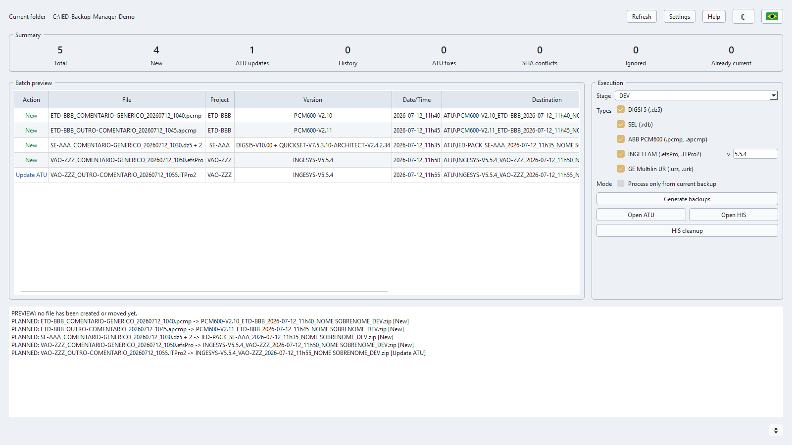
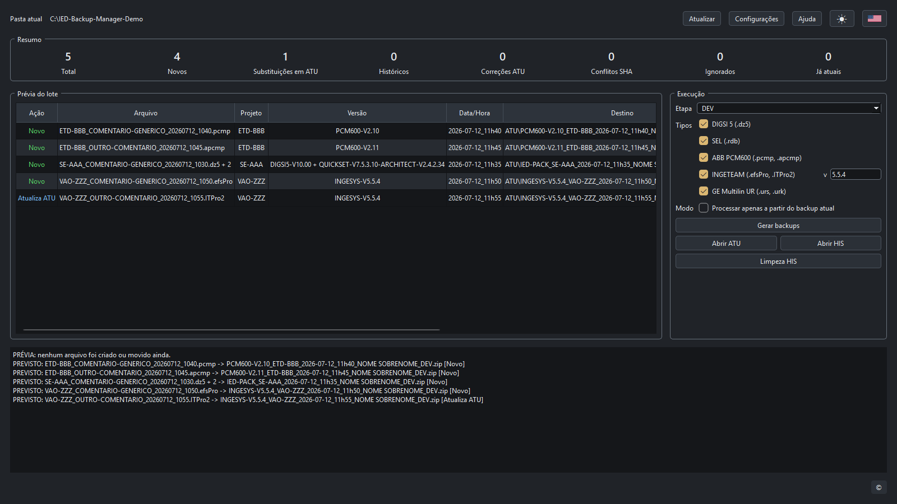
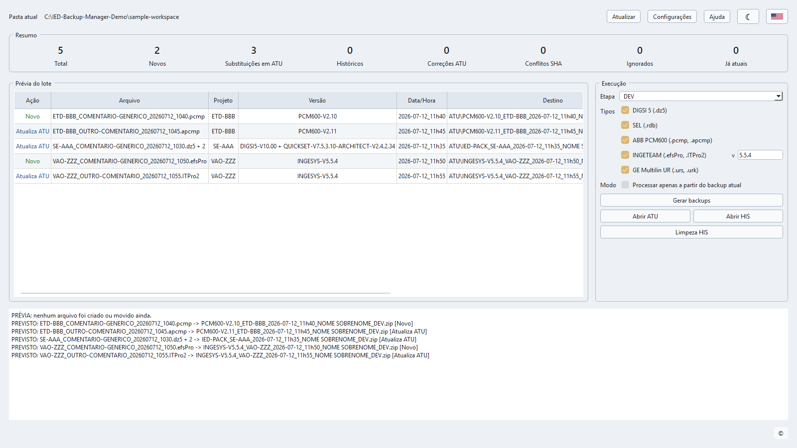
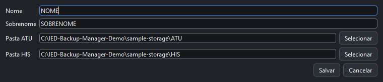
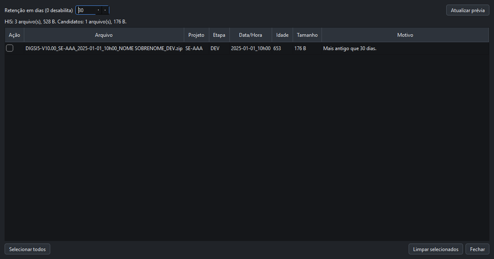
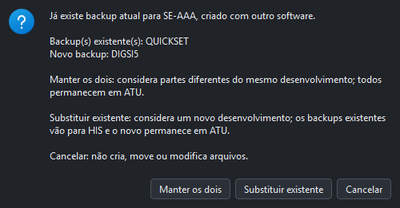

<p align="center">
  
</p>

<h1 align="center">IED Backup Manager</h1>

<p align="center">
  Standardized and traceable IED project backups, organized between
  <code>ATU</code> and <code>HIS</code>.
</p>

<p align="center">
  <a href="https://github.com/machado-jean/ied-backup-tool/actions/workflows/ci.yml"></a>
  <a href="https://github.com/machado-jean/ied-backup-tool/releases/latest"></a>
  <a href="https://github.com/machado-jean/ied-backup-tool/releases"></a>
  <a href="https://github.com/machado-jean/ied-backup-tool/releases/latest"></a>
  
  
  <a href="LICENSE"></a>
</p>

<p align="center">
  <a href="README.md">Português</a> · <a href="README.en.md">English</a> ·
  <a href="https://github.com/machado-jean/ied-backup-tool/releases/latest">Download latest release</a>
</p>

Windows application for standardizing IED project backups, keeping the current
backup in `ATU`, historical backups in `HIS`, and consistent ZIP names for
technical traceability. Current version: `1.18.0`.

- Executable usage guide: [docs/EXECUTABLE_USAGE.en.md](docs/EXECUTABLE_USAGE.en.md)
- Operational help: [docs/HELP.en.md](docs/HELP.en.md)
- IED identification logic: [docs/IED_IDENTIFICATION_LOGIC.en.md](docs/IED_IDENTIFICATION_LOGIC.en.md)
- Roadmap: [docs/ROADMAP.en.md](docs/ROADMAP.en.md)
- Public sample files: [docs/examples](docs/examples)
- How to contribute: [CONTRIBUTING.en.md](CONTRIBUTING.en.md)

## Overview

IED Backup Manager processes the working files in the executable folder,
identifies the project from the text before the first underscore `"_"`, converts
spaces in that text to hyphens, creates a
standard ZIP, and applies the current/history storage rules between `ATU` and
`HIS`.

The goal is to reduce inconsistent manual backups, avoid technical duplicates,
preserve history, and make audits easier without requiring users to rename final
backup files manually.

When older backups exist in `ATU`/`HIS` using the previous `YYYYMMDD-HHMM`
format, the application identifies them and asks whether the user wants to
rename them to the current pattern.

## Interface

### Preview before any change

The main screen detects source files, calculates destinations, and summarizes
new backups, replacements, history entries, conflicts, and skipped items. The
preview does not move or create files.



### Consistent light and dark themes

The theme button changes colors without changing interface geometry. The first
run follows Windows; an explicit choice is then saved in `config.json`.





### Local settings and controlled history cleanup

Collaborator and storage paths remain in the local `config.json`. `HIS` cleanup
shows retention, age, size, and reason, and deletes only explicitly selected
items after confirmation.





## Five-step workflow

| Step | Action | Result |
| --- | --- | --- |
| 1 | Place the executable with the working files | The local project is detected. |
| 2 | Configure collaborator, `ATU`, `HIS`, and IED types | Preferences stay in local `config.json`. |
| 3 | Select the stage and review the preview | Destinations, versions, and conflicts are visible. |
| 4 | Click `Generate backups` | Validated ZIPs go to `ATU`; older current backups move to `HIS`. |
| 5 | Use `HIS cleanup` when required | Old candidates are removed only after confirmation. |

## Main Features

- Windows GUI with batch preview before execution.
- Portuguese and English interface, saved in `config.json`.
- Quick light/dark theme toggle; the first run follows the system and a manual
  choice is then saved in `config.json`.
- Public online help opened according to the selected UI language.
- GitHub update check with clickable update notice.
- Direct download plus a `What's new?` link to the specific release page.
- Fixed executable name: `IED_Backup_Manager.exe`.
- Standard stages: `DEV`, `PRE-TAF`, `TAF`, `POS-TAF`, `PRE-TAC`, `TAC`,
  `POS-TAC`, and free description.
- Individual backups or grouped `IED-PACK` backups by project/substation.
- Metadata file `IEDS-BACKUP-INFO.txt` inside every generated ZIP.
- SHA256 source-file registration and integrity conflict detection.
- Validated `ATU`/`HIS` folders with assisted creation when missing.
- Operational quarantine folder `IED-QUARENTENA` for rare partial/suspicious
  files after copy or archive failures.
- Controlled `HIS` cleanup with retention, preview, and manual confirmation.
- Batch preview runs in the background to reduce freezes in large folders.
- Daily local log for startup, preview, backup, and failure diagnostics.
- Unexpected-exit detection with one marker per session, UUID/PID/start-time/
  executable-path validation, and consent-based Windows event collection without
  automatic uploads or UAC prompts.
- Responsive execution with per-file progress and controlled cancellation.

## Supported Types

| Type | Input | Version used in backup |
| --- | --- | --- |
| Siemens DIGSI | `.dz5` | Internal `.dp4v###` or `.dp5v###` marker, for example `DIGSI5-V10.00`. |
| SEL QuickSet / Architect | `.rdb`, optional `.scd` or `.selaprj` | QuickSet and Architect versions when found. |
| ABB PCM600 | `.pcmp`, `.apcmp` | `ProjectDataServer%versions.ini` inside the package. |
| INGETEAM INGESYS | `.efsPro`, `.ITPro2` | Manually entered by the user and saved in `config.json`. |
| GE Multilin / EnerVista UR | folders with `.urs` or `.urk`; optional `.ENV` | Highest version found between `GEMULTILIN`/`GEVERNOVA` headers in `.urs/.urk` and `UR Setup` headers in `.cid/.icd`, for example `GE-MULTILIN-V8.71`. |

## Naming Rule

The project, substation, bay, or equipment name is the text before the first
underscore `"_"`.

```text
SE-AAA_GENERIC-COMMENT_20260712_1030.dz5 -> Project: SE-AAA
ETD-BBB_OTHER-COMMENT.rdb                -> Project: ETD-BBB
VAO-ZZZ_GENERIC-COMMENT_20260712_1050.efsPro -> Project: VAO-ZZZ
```

Everything after the first underscore is treated as a user comment and is not
part of the technical backup key.
For example, a fictional `SE CCC` is normalized to `SE-CCC`.

## Software Version and Current Backup

The complete version remains in the ZIP name and historical identity, but it
does not create another current-backup slot. A newer version of the same family,
such as `DIGSI5-V10.00` after `DIGSI5-V9.00`, replaces the previous backup for
the same project in `ATU` and moves it to `HIS`.

When the same project already has an individual backup from another software
family, the application does not assume whether the work is complementary or a
new development. Before execution it offers `Keep both`, `Replace existing`,
and `Cancel`, with the effect of each action. An `IED-PACK` automatically
replaces only individual backups from the families included in that package.



## Public Sample Files

The [docs/examples](docs/examples) folder contains artificial files for public
testing and documentation screenshots. The sample workspace intentionally does
not include `config.json`, so the first GUI run starts without previous settings
and requires the user to fill `Settings`.

Suggested GUI command:

```powershell
.\.venv\Scripts\python.exe -m src.gui.app --project-dir ".\docs\examples\sample-workspace"
```

Use `FIRST` and `LAST` as first/last name and point `ATU`/`HIS` to
`docs\examples\sample-storage\ATU` and `docs\examples\sample-storage\HIS`.
For INGETEAM examples, use manual version `5.5.4`.

## Development

```powershell
python -m venv .venv
.\.venv\Scripts\python.exe -m pip install -r requirements.txt
.\.venv\Scripts\python.exe -m src.gui.app
.\.venv\Scripts\python.exe -m ruff check .
.\.venv\Scripts\python.exe -m pytest
```

Generate a local release executable only after validation:

```powershell
.\scripts\release.ps1
```

The command also generates `SHA256SUMS.txt` and `PUBLISH_RELEASE.ps1` inside
`releases\vX.Y.Z`. Verify the local artifacts before publishing:

```powershell
.\releases\vX.Y.Z\PUBLISH_RELEASE.ps1 -VerifyOnly
```

After committing and pushing `master`, publish manually with:

```powershell
.\releases\vX.Y.Z\PUBLISH_RELEASE.ps1
```

GitHub CLI must be installed and authenticated with `gh auth login`.
Before creating the GitHub Release, the publisher reruns lint and tests, requires
green CI on `master`, pushes the tag, waits for that tag's CI on the same commit,
and shows a report with every check marked `CORRETO` or `INCORRETO`. When all
checks pass, it asks `Publicar release com o release note e .exe?`; only an
affirmative answer creates the GitHub Release and uploads its assets. If any
gate fails, no GitHub Release is created.

## Privacy

Do not publish real backup files, local `config.json`, internal company paths,
real collaborator names, IP addresses, credentials, or operational engineering
data. Public examples should use generic names such as `SE-AAA`, `ETD-BBB`,
`VAO-ZZZ`, and `FIRST LAST`.

## License

Copyright (c) 2026 Jean Carlos Machado.

This project is provided for free, non-commercial use under the **IED Backup
Manager Non-Commercial License**. Commercial use, resale, sublicensing, paid
service offering, or incorporation into commercial products requires prior
written authorization.
